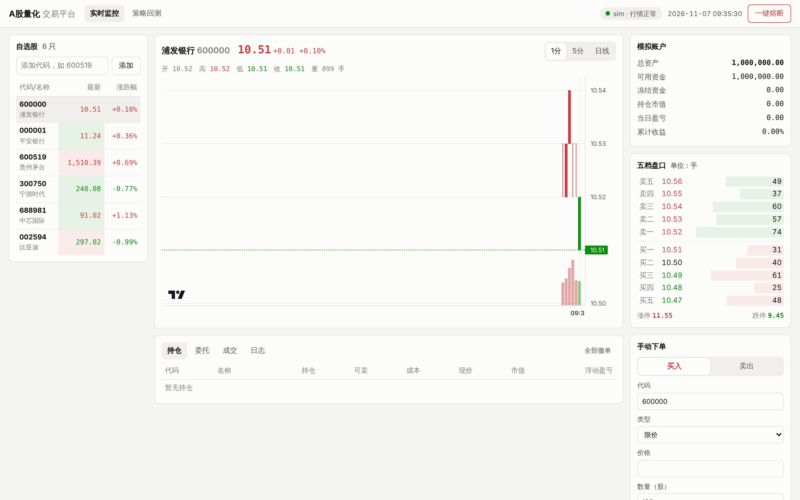
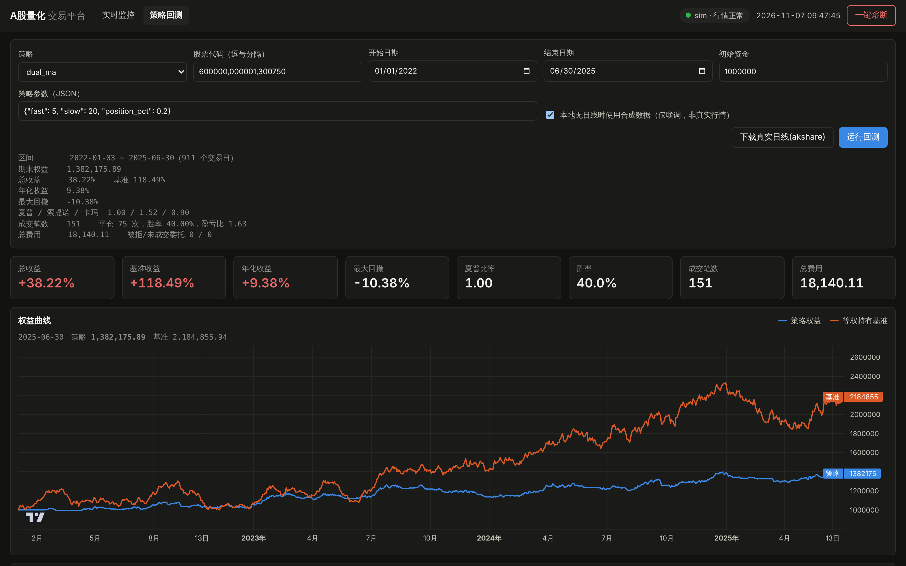

# A股量化交易平台（ashare-quant）

一个面向个人的 A 股量化交易平台：**准实时行情流 → 事件驱动引擎 → 策略 → 风控 → 模拟撮合 / 券商实盘 → Web 看板**，
回测与实盘共用同一套策略代码和 A 股交易规则。

> ⚠️ 本项目仅供学习研究，不构成投资建议。默认使用本地模拟撮合，接入实盘前请充分测试并遵守《证券市场程序化交易管理规定》的报告要求。




---

## 用到的开源项目

尽量复用 GitHub 上成熟的项目，只自己写「A 股特有」和「把它们串起来」的部分：

| 项目 | 用途 | 说明 |
|---|---|---|
| [akfamily/akshare](https://github.com/akfamily/akshare) | 行情 / 历史数据 | 东方财富五档盘口、全市场快照、日线、分钟线 |
| [tradingview/lightweight-charts](https://github.com/tradingview/lightweight-charts) | K 线 / 权益曲线图表 | 已随项目打包在 `quant/web/static/vendor/`，不依赖 CDN（Apache-2.0，保留 TradingView 标识） |
| [duckdb/duckdb](https://github.com/duckdb/duckdb) | 本地列存数据库 | 单文件、免安装，存 Tick / K 线 / 委托 / 成交，可直接写 SQL 做研究 |
| [fastapi/fastapi](https://github.com/fastapi/fastapi) + [encode/uvicorn](https://github.com/encode/uvicorn) | REST + WebSocket | 实时推送行情、账户、委托到浏览器 |
| [vnpy/vnpy](https://github.com/vnpy/vnpy)（设计参考） | 事件引擎 / K 线合成 / 指标缓存 | `EventBus`、`BarGenerator`、`BarSeries` 借鉴了 vnpy 的 EventEngine、BarGenerator、ArrayManager，改写为 asyncio 单线程模型 |
| xtquant（miniQMT，可选） | 推送行情 + 实盘交易 | 券商提供，见下文「实盘」 |

---

## 实时数据流：问题与方案

AKShare 很好用，但它本质是 **HTTP 轮询东方财富网页接口**，不是交易所推送。直接 `while True: ak.stock_zh_a_spot_em()` 会遇到：

| 问题 | 本项目的处理 |
|---|---|
| `stock_zh_a_spot_em` 全市场 5000+ 只要分 50+ 页、页间随机休眠，**一轮约 1 分钟** | 盯盘用 `quote` 模式：`stock_bid_ask_em` 逐只拉五档盘口，单只 100~300ms，几十只自选股可做到 3 秒一轮；`spot` 模式只用于选股扫描 |
| 请求太频繁会被**限流**（断开连接，首次约 5 分钟，反复触发 40 分钟以上） | 并发上限 + 轮询间隔 + 指数退避（5 → 10 → 20 → 40 分钟），识别 akshare 的 `Push2RateLimitError`，限流期间自动暂停 |
| 两次轮询之间常常没有新成交，下游重复计算 | 按 (最新价, 累计量, 买一, 卖一) 去重，只发布真正变化的快照 |
| 快照里成交量是「当日累计」 | `BarGenerator` 差分得到每分钟成交量；盘中启动时第一笔不计入；换日自动重置 |
| 集合竞价、午休、收盘时 K 线归属 | 9:25 竞价并入 9:30，11:30 / 15:00 并入前一分钟；无新行情时按事件时间定时强制收盘 |
| HTTP 请求阻塞事件循环 | `asyncio.to_thread` 丢线程池；撮合 / 策略走同步回调保证顺序；WebSocket、落盘走有界异步队列（满了丢最旧），慢消费者不拖慢行情 |
| 浏览器被高频 Tick 打爆 | WebSocket 按股票合并，每 250ms 只推最新一笔 |
| 非交易时段 / 周末没法调试 | `sim` 仿真行情源：加速时钟、遵守涨跌停、自动跳过午休、跨日测试 T+1 |
| **海外 IP 拿不到实时数据** | 东方财富会把境外 IP 重定向到延时行情（`push2delay`）或直接断开连接，**请在中国大陆网络运行 akshare 行情源** |

**真正的实时推送**（毫秒级、无限流）只能通过券商终端拿到。个人投资者最主流的是 **miniQMT**（`xtdata.subscribe_quote` / `subscribe_whole_quote` 全市场推送），本项目已提供 `qmt` 适配器，配置里把 `feed.type` 改成 `qmt` 即可切换，策略代码不用改。

建议的演进路线：**sim 联调 → akshare 准实时模拟盘 → miniQMT 推送行情 + 模拟账户 → 小资金实盘**。

---

## 架构

```
 DataFeed (sim / akshare / qmt)
     │ Tick
     ▼
 EventBus ──同步──▶ PaperBroker.on_tick（先撮合挂单）
     │      ├────▶ BarGenerator ─1m─▶ WindowBarGenerator(5m/15m/…) ─▶ Strategy.on_bar
     │      └────▶ Strategy.on_tick
     └──异步队列──▶ StoreWriter(DuckDB) / WebSocket
 Strategy.buy/sell ─▶ RiskManager ─▶ Broker(Paper / QMT) ─Order/Trade─▶ EventBus
```

```
quant/
├── core/        models（Tick/Bar/Order…）· rules（A 股规则）· calendar（交易时段）· events（事件总线）
├── data/        akshare_feed · sim_feed · bar_generator · store(DuckDB) · history（下载/合成数据）
├── engine/      broker（PaperBroker 模拟撮合）· risk（风控）· live（实时引擎）· qmt（miniQMT 适配）
├── strategy/    base（策略基类）· series（指标）· examples（双均线、通道突破）
├── backtest/    engine（日线事件驱动回测）· metrics（绩效）
└── web/         server（FastAPI）· static（前端）
```

### 内置的 A 股规则（`quant/core/rules.py`，回测和实盘一致）

- **T+1**：当日买入次日才能卖
- **涨跌停**：主板 10%、主板 ST 5%、创业板 / 科创板 20%、北交所 30%；委托价超出范围拒单；涨停封板买不进、跌停封板卖不出；日线回测一字板不成交
- **数量**：主板 / 创业板 100 股整数倍；科创板 ≥200 股；卖出零股须一次清仓
- **费用**：佣金（默认万 2.5，最低 5 元）、印花税 0.05%（仅卖出）、过户费 0.001%
- **资金冻结**：买单按委托价 + 预估费用冻结；市价单以涨跌停价作为保护价
- **当日有效**：换日自动撤销未成交委托
- **风控**：单笔金额、单票仓位、当日亏损熔断、每秒 / 每日报单数、撤单数、黑名单、禁买 ST、一键熔断

---

## 快速开始

需要 **Python 3.11 及以上**（akshare 最新版的要求）。旧版本 Python 可以保留，新版本可以和它共存。

### Windows：双击启动（推荐）

1. 安装 [Python 3.12](https://www.python.org/downloads/)，安装时勾选 **Add python.exe to PATH**
2. 在 GitHub 仓库页面点 **Code → Download ZIP**，解压
3. 进入解压后包含 `start.bat` 的文件夹，**双击 `start.bat`**

首次运行会自动创建虚拟环境并安装依赖（使用清华镜像，几分钟），然后自动打开 http://127.0.0.1:8000 。
要用东方财富实时行情，在该文件夹地址栏输入 `cmd` 回车，然后运行 `start.bat --feed akshare`。

### 命令行（macOS / Linux / Windows 均可）

```bash
cd ashare-quant
```

```bash
python -m venv .venv && source .venv/bin/activate   # Windows: .venv\Scripts\activate
```

```bash
pip install -r requirements.txt
```

**1. 仿真行情联调（任何时间、任何网络都能跑）**

```bash
python -m quant run
```

打开 http://127.0.0.1:8000 ，能看到加速的仿真行情、K 线、五档盘口，双均线策略会自动下单。

**2. 切换到 AKShare 实时行情（需中国大陆网络，交易时段）**

先测一下接口是否可用、延迟多少：

```bash
python -m quant probe 600000 000001
```

然后启动：

```bash
python -m quant run --feed akshare
```

或者直接修改 `config.yaml` 里的 `feed.type: akshare`。非交易时段启动会先拉一次最新价，之后自动暂停轮询。

**3. 下载真实历史数据并回测**

```bash
python -m quant download 600000 000001 300750 --start 20200101
```

```bash
python -m quant backtest dual_ma 600000 000001 300750 --start 2021-01-01 --params '{"fast": 5, "slow": 20}'
```

也可以在网页「策略回测」页里点「下载真实日线」和「运行回测」。没有真实数据时勾选「使用合成数据」可以先跑通流程（合成数据不代表真实行情，结果没有参考意义）。

> DuckDB 同一时间只允许一个进程写库：平台运行中时，命令行的 `download` 会提示先停平台，请改在网页里操作。

**4. 运行测试**

```bash
pip install -r requirements-dev.txt && python -m pytest -q
```

---

## 写自己的策略

```python
# mystrats/rsi.py
from quant.strategy import Strategy, BarSeries

class RsiStrategy(Strategy):
    interval = "5m"                       # 实时：1m/5m/15m/30m/60m；回测为日线
    default_params = {"n": 14, "low": 30, "high": 70, "position_pct": 0.2}

    def on_init(self):
        self.warmup = self.n + 1          # 实时引擎会用数据库里的分钟线预热
        self.series = {s: BarSeries(self.n + 1) for s in self.symbols}

    def on_bar(self, bar):
        s = self.series[bar.symbol]
        s.update(bar)
        if not s.ready:
            return
        rsi = s.rsi(self.n)
        if rsi < self.low and self.pos(bar.symbol) == 0:
            self.buy_value(bar.symbol, self.equity * self.position_pct)   # 自动换算整手
        elif rsi > self.high:
            self.sell_all(bar.symbol)                                     # 只卖可卖部分（T+1）
```

在 `config.yaml` 里挂上：

```yaml
strategies:
  - class: mystrats.rsi.RsiStrategy
    symbols: ["600519"]
    params: {n: 14, low: 25}
```

可用接口：`buy / sell`（不给价格即市价）、`buy_value`、`sell_all`、`cancel`、`pos`、`available`、`equity`、`cash`、`log`；
回调：`on_init / on_start / on_tick / on_bar / on_order / on_trade / on_stop`。策略异常会被隔离，连续出错 5 次自动停用，不会拖垮引擎。

---

## 实盘（miniQMT）

`quant/engine/qmt.py` 按 xtquant 官方接口编写了推送行情（`QmtFeed`）和交易（`QmtBroker`）适配器。
**⚠️ 这部分没有在真实 QMT 环境里验证过**，字段单位（如 tick 的 `volume` 是否为「手」）请对照你券商版本的文档核对，先用模拟账户跑通。

1. 向券商申请开通 QMT / miniQMT（一般有资产门槛），在 Windows 上以「极简模式」登录
2. `pip install xtquant`（或使用券商提供的包）
3. 修改 `config.yaml`：

```yaml
feed:   {type: qmt}
broker:
  type: qmt
  qmt: {path: 'D:\国金QMT交易端\userdata_mini', account_id: '你的资金账号'}
```

风控层对 QMT 同样生效。按规定，开展程序化交易前需要通过券商完成报告。

---

## 后续可以做

- **因子研究**：接入 [microsoft/qlib](https://github.com/microsoft/qlib) 做多因子选股，输出目标持仓给本平台执行
- **更多券商接口**：参考 [vnpy](https://github.com/vnpy/vnpy) 的各类 gateway
- **分钟线回测**：当前回测引擎是日线级别，分钟级可用 `download --minute` 积累数据后扩展
- **复权与除权**：实时模拟盘遇到除权除息日需处理持仓调整；回测默认使用前复权数据
- **新股**：注册制新股上市前 5 日无涨跌幅限制，尚未建模
- **告警**：在 `LOG` / `TRADE` 事件上挂企业微信、钉钉、Telegram 通知
